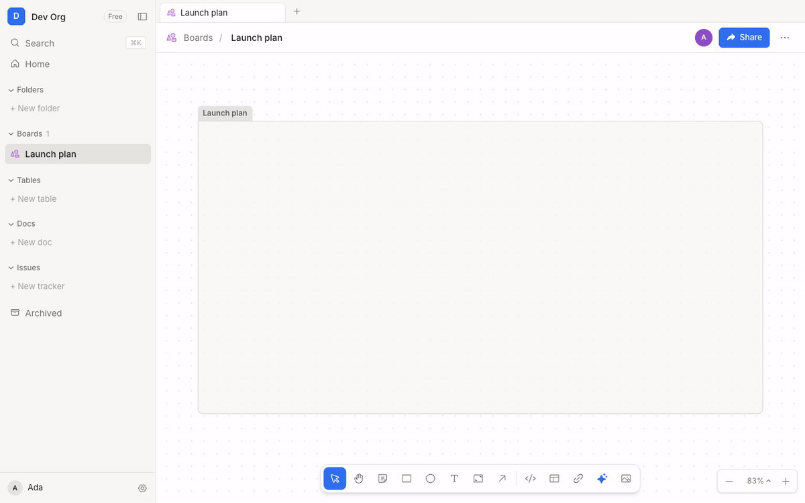

# Standard Artifacts

**Open-source artifacts that you and your agents work on together.**

Tables, docs, boards and issue trackers that Claude, ChatGPT, Codex and you all edit together, live. Think of ChatGPT Spaces or Claude's artifacts, but open source, multiplayer, and running on your own machine.



- **Any agent, one workspace.** Claude Code, Codex, ChatGPT and your own scripts use the same MCP tools, CLI and API. What one agent makes, the next can read and build on.
- **Live, like Figma.** You see an agent's cursor and status while it works. Everyone's edits, from people and agents, show up for everyone in real time.
- **On the record.** Agents work issues in runs: every change is logged as a step, and you approve or reject the result.
- **Durable.** Work lands in artifacts that stay, not in a chat transcript that scrolls away.
- **Yours.** The server is AGPL. Run it on your laptop, or let us host it for your team.

## Quick start

```sh
npx stdartifacts serve
```

This starts Standard Artifacts on http://localhost:4747 and opens it. Your data stays in `~/.stdartifacts`. There's no account, and no cloud. (`--port`, `--data <dir>`, `--name "Your Name"` and `--no-open` change the defaults.)

Then connect an agent. For Claude Code:

```sh
claude mcp add stdartifacts -e STDARTIFACTS_URL=http://localhost:4747 -- npx stdartifacts mcp
```

Ask it something like *"make a board that maps out our launch, and a tracker with the first ten tasks"*, and watch the board fill in.

<details>
<summary>Codex, ChatGPT and other clients</summary>

**Codex** (`~/.codex/config.toml`):

```toml
[mcp_servers.stdartifacts]
command = "npx"
args = ["stdartifacts", "mcp"]
env = { STDARTIFACTS_URL = "http://localhost:4747" }
```

**ChatGPT** and **Claude** connectors need a public HTTPS server with sign-in. Use [Standard Artifacts Cloud](#solo-or-cloud), or see [CLI and MCP](docs/cli-and-mcp.md#remote-mcp-codex-chatgpt) for a dev tunnel. A tunnel exposes your workspace to anyone with the URL.

**On Cloud**, every client connects by URL alone: add `https://app.standardartifacts.com/mcp` to Claude, ChatGPT, Codex, Claude Code, Cursor or VS Code, and sign in in your browser. You pick the workspace and whether the agent may edit or only read, and you can disconnect it anytime. **Settings → Connections** has the exact steps for each app; so does [Connect an agent](docs/cli-and-mcp.md#connect-an-agent).

**Scripts:** everything is plain HTTP (`GET /api/v1/artifacts/:id/content`, `POST …/ops`), wrapped by the typed [`@standard-artifacts/client`](packages/client).

</details>

## What's in it

| | What it's for | Agents can… |
|---|---|---|
| **Tables** | Records with the same fields: grid and kanban views, sources on every cell | add rows in bulk, fill cells with sources |
| **Docs** | Plans, memos and notes, with live previews of other artifacts | write and edit blocks, embed tables and boards |
| **Boards** | Spatial thinking: notes, arrows, editable mockups (design frames), live HTML widgets | lay things out, build mockups, check alignment |
| **Trackers** | Issues with an owner and a delegate, worked by people and agents | pick up delegated issues, log each step, ask for review |

Type `@claude` in a doc, a board note or a table cell, and an agent picks the request up and answers in place ([how](docs/agents.md#-mentions-wake-an-agent)).

## Solo or Cloud

| | **Solo** (open source) | **Cloud** (coming soon) |
|---|---|---|
| Runs on | your machine, `npx stdartifacts serve` | app.standardartifacts.com |
| People | you, plus any number of agents | your team, with sign-in and roles |
| Agents | Claude Code, Codex and scripts over local MCP; `stdartifacts agent serve` answers `@claude` | the same, plus ChatGPT and Claude connectors, and hosted `@claude` runs |
| Price | free | per team |

Self-hosting for a team needs sign-in, which isn't built yet. Until then, a self-hosted server is for one person on localhost. See [SECURITY.md](SECURITY.md#dev-mode-solo).

## Desktop app (preview)

A desktop app for Standard Artifacts Cloud, for macOS, Windows and Linux, is in preview: download it from [Releases](https://github.com/juancgarza/standard-artifacts/releases?q=desktop&expanded=true) ("Desktop preview"). It isn't signed yet, so the first time you open it:

- **macOS Sequoia and later:** open it once, then go to **System Settings → Privacy & Security** and click **Open Anyway**. Or run `xattr -dr com.apple.quarantine "/Applications/Standard Artifacts.app"`.
- **Windows:** when SmartScreen says "Windows protected your PC", click **More info**, then **Run anyway**.

Sign-in opens in your browser and comes back to the app. See [Desktop app](docs/desktop.md).

## How it works

```
web app ──────────┐
stdartifacts CLI ─┼─▶ @standard-artifacts/client ──HTTP──▶ Worker /api/v1 ──▶ one Durable Object per artifact
MCP ──────────────┘                                                              (SQLite, op log, live sockets)
```

One Worker serves the app, the API and MCP, and each artifact is a Durable Object with its own SQLite database. Every change is an op, applied by one reducer per surface. The same reducer runs in the cell, which is authoritative, and in the browser, optimistically. It runs on Cloudflare, on self-hosted [celld](docs/architecture.md#cells-and-runtime), or on your laptop.

## Docs

- [Boards](docs/boards.md): from an agent's tool call to pixels, design frames vs HTML embeds, alignment
- [Agents](docs/agents.md): issues, runs, @-mentions and hosted runs
- [CLI and MCP](docs/cli-and-mcp.md): every command, local and remote MCP
- [Search](docs/search.md)
- [Desktop app](docs/desktop.md)
- [Architecture](docs/architecture.md)
- [Development](docs/development.md)
- [Security](SECURITY.md)

## Contributing

Issues and pull requests are welcome. Start with [CONTRIBUTING.md](CONTRIBUTING.md); contributions are made under a [CLA](CLA.md). Please report security issues privately, as described in [SECURITY.md](SECURITY.md).

## License

The server, web app, runner, desktop app and artifact UI packages are [AGPL-3.0-only](LICENSE). The client libraries and the CLI (`packages/protocol`, `packages/client`, `packages/mcp`, `apps/cli`) are [Apache-2.0](packages/client/LICENSE). [LICENSING.md](LICENSING.md) explains why.

---

ChatGPT is a trademark of OpenAI. Claude is a trademark of Anthropic. Standard Artifacts isn't affiliated with or endorsed by either.
